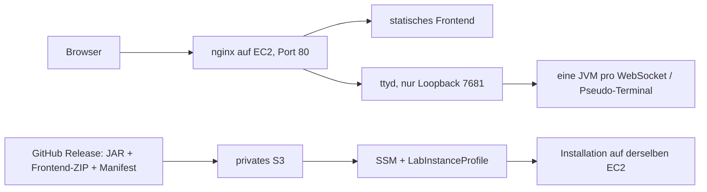
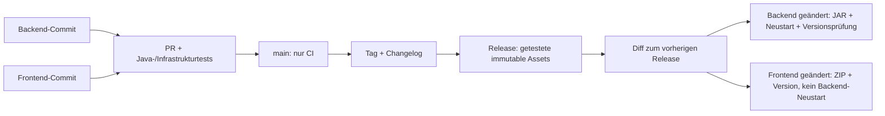

# TicTacTest: Deployment, Secrets und Reflexion

Diese Anleitung ersetzt die erste Cloud-Iteration in `CLOUD.md`. Die konkreten
Laufnachweise werden in [deployment-nachweise.md](deployment-nachweise.md) geführt.
Lokaler Betrieb ausschliesslich aus Release-Assets: [webkonsole.md](webkonsole.md).

## Architektur und Trennung



OpenTofu verwaltet EC2, LabInstanceProfile-Zuordnung, Elastic IP, Netzwerk,
Erstinstallation, nginx, Unit und SSM-Laufzeitkonfiguration. Das App-Deployment
verwaltet nur JAR, Frontend-Dateien und deren Versionsmetadaten. **Kein
Deployment-Workflow ruft OpenTofu auf.** Ein Push auf main startet CI, aber
kein App-Deployment. Die bestehende Coverage-Pages-Pipeline ist unabhängig
von der TicTacTest-App und wird nicht als App-Deployment gewertet.

Die feste Adresse ist eine Elastic IP. Ein Stop/Start behält sie bei; ein
`destroy` gibt sie frei. Der zugehörige AWS-DNS-Name steht als `web_url` im
Output. In diesem Schulnetz funktioniert die AWS-DNS-Adresse, während der
direkte HTTP-Aufruf der neuen numerischen IP eine vorgeschaltete 403-Seite
liefern kann. Die Anwendung liefert unter ihrem AWS-DNS-Namen normal aus.

Frontend-Hosting erfolgt bewusst ebenfalls auf nginx statt in einem öffentlichen
S3-Bucket: same-origin für iframe, WebSocket und Versionsabfrage; weniger
CORS-/Mixed-Content-Probleme und kein öffentlicher Artefakt- oder State-Bucket.
Die bereitgestellte Unterrichtsdemo nutzt HTTP. Für öffentlichen produktiven
Betrieb wären Domain, TLS, Authentisierung und Rate-Limits zu ergänzen.

Portregeln: 80 für Frontend, Terminal-Proxy und Versionsabfragen; SSH 22 nur
für die vertrauenswürdige /32 des Arbeitsplatzes. 7681 ist nur auf Loopback
gebunden und nicht freigegeben. 8080 aus dem Prototyp ist geschlossen.
Ausgehend sind AWS-API-, DNS- und Paketabrufe möglich.

ttyd ist auf 1.7.7 mit Hersteller-SHA-256 festgelegt. Corretto und nginx sind
mit Paketversion in `infrastructure/runtime/provision.sh` festgelegt. Deren
transitive Pakete stammen aus den signierten Amazon-Linux-Repositories;
ein vollständiger Paket-Snapshot wird nicht behauptet. Die Laufzeit startet
nie eine frei nutzbare Shell und läuft mit eigenen unprivilegierten Rechten.

## Einmaliger Infrastrukturaufbau

AWS-Lab starten, Profil mit allen drei temporären Werten ausserhalb des
Repositories einrichten. Region ist hier `us-east-1`. Keine eigenen IAM-Rollen:
`data.aws_iam_instance_profile.lab` liest das vorhandene `LabInstanceProfile`.
SSM-Agent und AWS CLI sind im Amazon-Linux-Image vorhanden. Die EC2 verwendet
die automatisch gelieferten Rollen-Credentials, keine statischen Access Keys.

State-Bucket und privater Artefakt-Bucket sind Bootstrap-Ressourcen. Namen
müssen global eindeutig sein, beispielsweise mit Account-ID und Zufallssuffix.
Der Artefakt-Bucket wurde zuerst mit `bucket_prefix` erstellt. Dieses Lab
verweigert dem AWS-Provider danach `GetBucketObjectLockConfiguration` durch
eine Organisationsrichtlinie. Deshalb ist die Bucket-Erstellung aus dem State
gelöst worden; Zugriffssperre, SSE-S3 und Versionierung bleiben in OpenTofu.
Es werden keine IAM-Sperren umgangen. Für einen Neuaufbau:

```powershell
$env:AWS_PROFILE = 'default'
$env:AWS_REGION = 'us-east-1'
$env:AWS_DEFAULT_REGION = 'us-east-1'
aws sts get-caller-identity
$bucket = "tictactest-artifacts-$([guid]::NewGuid().ToString('N'))"
aws s3api create-bucket --bucket $bucket --region us-east-1
# artifact_bucket = "..." in infrastructure/terraform.tfvars setzen
tofu '-chdir=infrastructure' init
tofu '-chdir=infrastructure' plan '-out=infra.tfplan'
tofu '-chdir=infrastructure' apply infra.tfplan
tofu '-chdir=infrastructure' output
```

Bestehenden S3-State migrieren statt mit leerem State neu beginnen; Anleitung
in `CLOUD.md`. State gehört ausschliesslich in den privaten State-Bucket.
OpenTofu erzeugt die Runtime-Skripte, Unit, nginx-Konfiguration und `config.js`.
`user_data_base64` enthält gzip-komprimiertes cloud-init für den ersten Boot.
Eine SSM-Association richtet auch die vorhandene Instanz ein und erlaubt
bewusste Infrastruktur-Updates. `user_data_replace_on_change = false` verhindert
eine Ersetzung; Updates können einen Stop/Start auslösen. `user_data` lädt
**kein Release-JAR** herunter. Nach dem Boot wird das bereits installierte JAR
vom persistenten EBS-Volume verwendet. Das Release ist keine IaC-Variable.

Outputs: `web_url`, `console_url`, `backend_version_url`, `frontend_version_url`,
`instance_id`, `artifact_bucket`, `public_ipv4`, `security_group_id`. Diese
Werte sind Konfiguration, keine Zugangsdaten. State selbst kann sensible
Informationen enthalten und wird trotzdem nicht öffentlich oder im Repo abgelegt.

## Secrets-Konzept

| Wert | Ablage | Quelle / Gültigkeit |
|---|---|---|
| AWS_ACCESS_KEY_ID, AWS_SECRET_ACCESS_KEY, AWS_SESSION_TOKEN | GitHub Environment `production`, Secrets | vollständiger Satz derselben Learner-Lab-Sitzung; läuft ab |
| GITHUB_TOKEN | automatisch je Job | nur Release-Assets lesen bzw. im Release-Job veröffentlichen |
| AWS_REGION, INSTANCE_ID, ARTIFACT_BUCKET, APP_URL | Environment Variables | lokale OpenTofu-Outputs, keine Geheimnisse |
| AUTO_DEPLOY | Repository Variable | normalerweise `true`; für die ersten beiden manuellen Übungen `false` |

Der finale Workflow benötigt **keinen SSH-Schlüssel**, keine SSH-Runner-Regel
und keinen Zugriff auf den OpenTofu-State. SSM hat gegenüber SSH den Vorteil,
dass kein eingehender CI-Zugang und kein privater SSH-Key nötig ist; es benötigt
aber Agent, Instance Profile und passende AWS-API-Rechte. Im Lab ist die Rolle
vorgegeben und breiter als ideal. Ausserhalb des Labs würden minimale getrennte
Deployment- und Instance-Rollen nur auf diesen Bucket und diese EC2 berechtigt.

Vor jedem Deployment wird `aws sts get-caller-identity` ausgeführt. Mit
abgelaufenen Credentials schlägt der Workflow **vor** S3/SSM-Mutationen fehl.
Neue Sitzung starten, alle drei Werte gemeinsam unter Settings → Environments →
production → Secrets aktualisieren, dann den vorhandenen Release mit „Deploy
release → Run workflow“ erneut deployen. Das JAR wird dabei nicht neu gebaut.
Die zuverlässige manuelle Erneuerung bleibt eine Lab-Aufgabe; ein Workflow kann
keine neue Lab-Sitzung erfinden. Eine absichtlich ungültige Credential-Prüfung
gehört zum Fehlernachweis, nicht zu einem veröffentlichten kaputten Release.

Secrets sind nach Speicherung nicht im Klartext lesbar. Berechtigte Maintainer
und Workflows können sie benutzen; wer Workflow-Code ändern darf, ist daher
sicherheitsrelevant. PR-Tests verwenden keine AWS-Secrets. Fork-PRs erhalten
normalerweise keine Secrets; `pull_request_target` wird nicht genutzt. GitHub
maskiert bekannte Secret-Werte in Logs, aber abgeleitete/transformierte Werte
können trotzdem lecken. Deshalb kein `set -x`, kein Ausgeben von Umgebungen,
Credentials oder State und keine Uploads solcher Dateien als Artefakte.

Bei Leak: Zugang sofort sperren/rotieren bzw. Lab-Credentials erneuern,
Auswirkungen/AWS-Aktivitäten prüfen, Logs und Git-Historie bereinigen. Das
Löschen einer Datei macht bereits veröffentlichte Schlüssel nicht wieder sicher.
Die im Chat früher geteilten temporären Credentials sind kein dauerhaftes
Produktionsgeheimnis und müssen spätestens vor der nächsten Sitzung ersetzt werden.

In einem Unternehmen: GitHub OIDC mit kurzlebigen STS-Sessions statt gespeicherten
AWS-Schlüsseln. Trust Policy auf Repository, Environment und Audience beschränken;
`id-token: write` nur für das Deployment. Siehe
[GitHub OIDC mit AWS](https://docs.github.com/en/actions/how-tos/secure-your-work/security-harden-deployments/oidc-in-aws).

## Release-Erkennung und Artefakte

Die Veroeffentlichung erfolgt zuerst als Draft: acht Assets hochladen, alle
Pruefsummen erneut pruefen, dann veroeffentlichen. Beobachtete GitHub-5xx
werden begrenzt wiederholt. Bereits publizierte Assets werden nicht ersetzt.

Ein `v*`-Tag baut und testet das JAR im **Release-Job**, paketiert plain
Frontend-Dateien und veröffentlicht JAR, Frontend-ZIP, lokale Tools,
`deployment.json` und SHA-256-Dateien. Deployment baut nichts. Die Java-Quellen
werden beim Betrieb nicht geändert oder auf EC2 kompiliert.

`scripts/release_assets.py` liest alle Seiten der GitHub-Release-API und wählt
den zuletzt veröffentlichten App-Release, dessen Tag ein Git-Vorfahre des
Zieltags ist. Bei gleicher Veröffentlichungszeit entscheidet der Tagname.
Drafts, reine Git-Tags und Devcontainer-Releases sind keine Kandidaten. Beim
erneuten Paketieren eines bereits veröffentlichten Releases werden später
veröffentlichte Releases ausgeschlossen. API-, Authentisierungs- und Git-Fehler
brechen ab; nur eine erfolgreiche Suche ohne Kandidaten gilt als erster Release.
Das Paketieren benötigt deshalb `gh` mit Repository-Lesezugriff (`GH_TOKEN` in CI).
Es vergleicht die
vollständige Strecke `git diff --name-only PREVIOUS TAG`, nicht nur den letzten
Commit. Sonst gingen Änderungen aus mehreren Commits zwischen Releases verloren.
Devcontainer-Tags werden ausgeschlossen. Beim ersten Release gilt beides als
geändert. `fetch-depth: 0` sichert die Historie. Der Actions-`paths`-Filter löst
Workflows für Ereignisse aus; er ersetzt keine komponentenbezogene Release-Differenz.

| Pfade | Wirkung |
|---|---|
| src/main/, build.gradle, settings.gradle, gradle/, gradle.properties, gradlew, gradlew.bat | Backend |
| frontend/ | Frontend |
| deploy/, infrastructure/runtime/, scripts/release_assets.py | beide (gemeinsamer Betrieb/Packaging) |
| VERSION, CHANGELOG.md, docs/, README, Tests | keine App-Komponente |
| Workflow-Dateien, scripts/publish_release.py, scripts/deploy_cloud.py | Transport-/Release-Werkzeug; kein automatischer App-Neustart |

Die Versionsnummer allein zählt nicht als Backend-Änderung: Ein neuer
JAR-Manifestwert würde sonst jeden Frontend-Release zum Backend-Release machen.
Alle Assets werden zwar reproduzierbar für den Tag bereitgestellt, aber im
automatischen Deployment wird nur die im Manifest markierte Komponente aktiviert.
Backend- und Frontend-Version können daher absichtlich verschieden sein.

`deployment-state.json` auf EC2 merkt den zuletzt angewandten Release. Ist die
Umgebung nicht auf dem im Manifest erwarteten Vorgänger (z. B. nach Rollback,
ausgelassenem Release oder Neuaufbau), werden beide Komponenten hergestellt.
Ein manueller gezielter Deploy stellt ebenfalls immer beide Komponenten her.
Die manuelle Wiederholung ist deshalb ein Wiederherstellungsmodus, kein Test
für „Frontend-only“; dieser Nachweis benötigt einen normalen neuen Release.

## Manuelles Deployment A und B ohne IaC

Die folgenden Schritte sind identisch zur CI. Der Repo-Checkout stellt nur das
Deployment-Werkzeug; JAR und Frontend stammen ausschliesslich aus dem Release.
Auch der manuelle Python-Deploy benötigt jetzt eine angemeldete GitHub CLI mit
Release-Lesezugriff. Er prüft vor jedem S3-Upload, dass der angeforderte Tag
streng `vMAJOR.MINOR.PATCH` entspricht und ein passender veröffentlichter Release
mit `isDraft=false` und gesetztem `publishedAt` existiert. Derselbe Check läuft
im Workflow bereits vor dem Download. API-Fehler, Drafts und fehlende Releases
brechen ohne Upload ab. Tag, Manifest-Prüfsumme und beide Artefakt-Hashes werden
vor dem Upload geprüft.
Assets mit Browser oder `gh release download TAG --dir release-assets`
herunterladen. Für einen neuen Tag einen leeren Downloadordner verwenden.

```powershell
$env:TAG = 'v1.3.0' # für Release B auf dessen Tag ändern
$env:FORCE = 'true'
$env:INSTANCE_ID = tofu '-chdir=infrastructure' output -raw instance_id
$env:ARTIFACT_BUCKET = tofu '-chdir=infrastructure' output -raw artifact_bucket
$env:APP_URL = tofu '-chdir=infrastructure' output -raw web_url
Get-ChildItem release-assets/*.sha256 | ForEach-Object {
  $parts = (Get-Content $_.FullName) -split '\s+'
  $actual = (Get-FileHash "release-assets/$($parts[1])" -Algorithm SHA256).Hash.ToLower()
  if ($actual -ne $parts[0]) { throw 'Checksum mismatch' }
}
python scripts/deploy_cloud.py
Invoke-RestMethod "$env:APP_URL/backend-version.json"
Invoke-RestMethod "$env:APP_URL/version.json"
tofu '-chdir=infrastructure' plan
```

Zwischen A und B erfolgt **kein** `tofu apply` und keine EC2-Ersetzung. Die
Pipeline verwendet dieselben S3-/SSM-Schritte. S3 liegt privat; auch private
GitHub-Repositories funktionieren, weil der Actions-Job Assets mit GITHUB_TOKEN
liest und die EC2 nur über ihre Rolle aus S3 liest.

Der Installer prüft Prüfsummen und JAR-Manifest und startet das neue JAR vorab
probeweise. Nach Installation und ttyd-Neustart genügt der Token-Endpunkt allein
nicht: Das installierte JAR wird zusätzlich mit dem aus systemd gelesenen User
und der Group gestartet, ohne geerbte Root-Zusatzgruppen. Das Gegner-Menü wird
gegebenenfalls mit 1 beantwortet; erst der Zugprompt bestätigt den Spielstart.
Jede Probe hat höchstens 20 Sekunden und ihre Prozessgruppe wird danach beendet.
Das unterstützt auch ältere JARs ohne Gegner-Menü. Erst anschliessend wird die
Backend-Versionsdatei atomar aktualisiert. Bei Aktivierungsfehlern werden das
vorige JAR und die Metadaten wiederhergestellt, der Dienst neu gestartet und das
alte Spiel erneut als Dienstbenutzer geprüft. Auch ein fehlgeschlagener
Wiederherstellungsversuch wird als Fehler weitergegeben. Ohne vorherige
Installation wird der fehlgeschlagene Dienst gestoppt und das neue JAR entfernt.

Vor einem selektiven Deployment liest der Job die öffentlichen Versionen der
laut Manifest unveränderten Komponenten. Sind diese nicht erreichbar, bricht er
vor dem Upload ab; ein bewusster manueller FORCE-Deploy benötigt diese Baseline
nicht. Geänderte Komponenten müssen unabhängig vom Installer-Bericht exakt die
Version des geprüften Releases liefern, unveränderte ihren vorher gelesenen
Stand. Berichtstag, boolesche Änderungsflags und Berichtsversionen werden gegen
diese Vorgaben geprüft. Der Installer darf bei Vorgängerabweichung beide
Komponenten aktualisieren, aber keine laut Manifest erforderliche auslassen.
Ein falscher Bericht zusammen mit denselben falschen HTTP-Versionen reicht
deshalb nicht mehr für Erfolg. Danach prüft der Job beide Versionen öffentlich per HTTP
(bis 20 Versuche à 2 Sekunden, HTTP-Timeout 4 Sekunden). Fehler schlagen den
Workflow fehl. SSM hat zusätzlich einen 240-Sekunden-Gesamttimeout.

Frontend-ZIP wird in ein eigenes Versionsverzeichnis entpackt, Pfadtraversal und
`config.js` darin werden abgewiesen. Jeder Aktivierungsversuch verwendet ein
frisches Verzeichnis mit Versionspräfix und Zufallssuffix, auch bei erneutem
Deploy derselben Version. Der aktive Baum wird niemals vorab gelöscht. Erst nach
vollständigem Kopieren und Setzen der Leserechte ersetzt ein atomarer Symlink den gesamten
ausgelieferten Baum; entfernte Dateien verschwinden damit ebenfalls. Die von
IaC erzeugte Datei `/opt/tictactest/config.js` liegt ausserhalb dieses Baums und
wird über eine eigene nginx-Location ausgeliefert. Ein versehentliches Löschen
würde Terminal-URL und Versionsanzeige beschädigen; das Deployment darf sie daher
gar nicht verwalten. Frontend-Deploys starten ttyd nicht neu.

GitHub `concurrency` serialisiert Deployments; ein zusätzlicher `flock` auf der
Instanz schützt auch vor einem gleichzeitig gestarteten manuellen Deploy.
Der Infrastruktur-Bootstrap verwendet denselben Lock bereits vor dem Schreiben
der Runtime-Dateien. Damit werden auch Erstboot und SSM-Provisionierung gegen
App-Aktivierungen serialisiert. Der Deployment-Workflow archiviert einen
erfolgreichen HTTP-Prüfbericht als `deployment-result-…`-Artefakt.
Runtime-Dateien werden vor der Veröffentlichung vollständig vorbereitet und
einzeln atomar ersetzt. Das schliesst auch das Lesen des Installers vor seinem
Lock ein; Details und verbleibende Grenzen stehen im folgenden Runtime-Nachtrag.

## Rollback, Neustart und Wiederaufbau

Actions → Deploy release → Run workflow → existierenden Tag eingeben. Der
Workflow verwendet aktuelle Deployment-Werkzeuge, lädt aber die Artefakte des
gewählten Tags. Bereits veröffentlichte Legacy-Releases ohne Frontend benötigen
einmalig ergänzte kompatible Frontend-/Manifest-Assets; ihre JARs bleiben unverändert.
Solche Ergänzungen müssen als Migration in den Release-Notes gekennzeichnet werden.

Ein normaler Stop/Start erhält EBS, App-Dateien, Versionen und EIP. systemd
aktiviert nginx und ttyd beim Booten. Ein Backend-Neustart bricht laufende Partien
ab, ein reiner Frontend-Deploy lässt die verbundenen Java-Prozesse weiterlaufen.

Nach `destroy`/`apply` ändern sich Instanz-ID, EIP, DNS und ggf. Ressourcen-IDs;
das Rootvolume ist neu. Private Bootstrap-Buckets und Release-Assets bleiben
erhalten. Outputs nach GitHub Variables übernehmen (`INSTANCE_ID`, `APP_URL`,
ggf. `ARTIFACT_BUCKET`), SSM-Onlinezustand abwarten und gewünschten Release manuell
deployen. Keine statische JAR-Version gehört in user_data.

Ein echter Lab-Session-Wechsel muss über die Lab-Oberfläche erfolgen. Stop/Start
testet die technische Persistenz, ersetzt aber keinen Nachweis für das Verhalten
der Lab-Plattform. Der vollstaendige destroy/apply-Versuch wurde auf dem Lern-Stack ausgefuehrt
und Release 1.3.4 auf der neuen Instanz wiederhergestellt. Alte und neue Werte
sowie der erfolgreiche Actions-Lauf stehen im Nachweis. Nur ein echter
Session-Wechsel ueber die Learner-Lab-Oberflaeche bleibt manuell zu pruefen.

### Letzter manueller Plattformtest beim nächsten Unterricht

1. Vor dem Beenden die Spieladresse und beide aktuellen HTTP-Versionen notieren.
   Nach dem Feature-Release 1.4.0 sind beide 1.4.0; für spätere Releases immer
   die unmittelbar vor dem Lab-Ende abgefragten Werte vergleichen.
2. In der Learner-Lab-Oberfläche **End Lab** ausführen, danach **Start Lab**
   und auf die Bereitschaft warten. Kein Lab-Reset verwenden.
3. Die neue vollständige Credential-Dreiergruppe lokal und vor dem nächsten
   CI-Deploy in den drei GitHub-Secrets der Umgebung production aktualisieren.
4. Dieselbe Spieladresse öffnen, eine Partie spielen und `/backend-version.json`
   sowie `/version.json` vergleichen. Es soll kein App-Deployment nötig sein.
   Falls die Plattform die EC2 gestoppt lässt, dieselbe Instanz starten und
   diesen Unterschied zum automatischen Lab-Wiederanlauf dokumentieren.
5. Ergebnis und Datum im Nachweis ergänzen. Damit wird das Plattformverhalten
   zusätzlich zu den bereits bestandenen EC2-Stop/Start- und Neuaufbau-Tests belegt.

## Reflexion: Weg einer Änderung und Promotion



Automatisiert: Release-Build, Checksummen, Differenz, Übertragung, Aktivierung
und Versionsprüfungen. Manuell: Änderungen/Review, Versions-Tag, IaC-Änderungen,
Lab starten und Secrets erneuern. Die Veröffentlichung eines Releases geht in
dieser Übungsumgebung direkt nach `production`, ohne zusätzliche Freigabe.

Für dev/staging/prod: dieselben Module, aber getrennte States/Backend-Keys,
Instanzen, EIPs, Speicherpräfixe, Secrets und GitHub Environments. Gleich bleiben
Laufzeit und Installationslogik; unterschiedlich sind URLs, Kapazität, Netzregeln
und Zugriffsrechte. Drei Environment-Tags allein trennen keine Infrastruktur.

Promotion baut **einmal** und reicht genau dieselben geprüften Assets und deren
Digests weiter. Pro Umgebung neu bauen würde einen anderen, noch ungeprüften
Stand erzeugen. Vorschlag: Tag veröffentlicht Kandidat → automatisches dev →
Smoke-/Terminaltest → staging mit Integrations-/Lasttests → manuelle Freigabe
durch berechtigte Required Reviewers des prod-Environments → Produktion mit
Healthcheck und Rollback-Möglichkeit. Ein Push allein deployt auch dann keine
Produktion; die Trigger für dev sind eine explizite spätere Designentscheidung.

Bei unterschiedlich weit fortgeschrittenen Umgebungen darf man nicht blind den
globalen vorherigen Release als ihren Istzustand annehmen. Jede Umgebung benötigt
ihren eigenen zuletzt deployten Stand oder Komponenten-Digests. Unser Iststand-
Abgleich erkennt Abweichungen und stellt dann beide Zielkomponenten her; eine
ausgebaute Promotion-Pipeline würde pro Umgebung die wirklich fehlenden Digests
übertragen und nur nötige Komponenten aktivieren.

## Lokale Absicherung vom 18. November 2026

Die P1/P2-Korrekturen wurden ausschliesslich lokal implementiert. Es erfolgten
kein AWS-Deployment, kein Apply, kein Push, keine Release-Veröffentlichung und
keine Änderung von Secrets. `scripts/test_deployment_safety.py` enthält
Regressionen für falsche Installer-/HTTP-Versionen, selektive Stände, FORCE,
Drafts und fehlende Releases, Manifest-/Artefaktprüfung, veröffentlichte
Vorgänger einschliesslich Pagination und Fehlern, Dienstbenutzer-Spielstart,
Legacy-JARs, Timeout, Backend-Rollback und Frontend-Aktivierungsfehler.

Ausgeführt mit Python 3.12 unter Windows:

```powershell
python -B -m unittest discover -s scripts -p 'test_*.py' -v
tofu '-chdir=infrastructure' fmt -check -recursive
tofu '-chdir=infrastructure' validate -no-color
git diff --check
```

Ergebnis: 29 Tests, 28 bestanden, 1 übersprungen; Exit-Code 0. Der echte
Symlink-Wechseltest wird auf diesem Windows-Konto mangels Symlink-Rechten
übersprungen. Die Fehlerbereinigung bei gescheitertem Umschalten wurde mit
simulierten Betriebssystemaufrufen erfolgreich getestet. Formatprüfung,
OpenTofu-Validierung und Whitespace-Prüfung bestanden ebenfalls. AWS, GitHub,
systemd und Java-Prozesse sind in den neuen Regressionstests simuliert.
Die vorhandene Linux-CI und jetzt auch der Release-Job führen diese Tests aus;
ein neuer Remote-Lauf wurde noch nicht gestartet.

Verbleibende Abnahme nach ausdrücklicher Freigabe:

- Den geänderten Infrastruktur-Installer und Bootstrap-Lock bewusst über den
  Infrastrukturprozess aktivieren. Ein reines App-Deployment aktualisiert sie
  weiterhin nicht. Die laufende EC2 wurde hier nicht geändert.
- Auf Linux den echten Symlink-Wiederholungsdeploy und einen Java-Start als
  systemd-Benutzer einschliesslich Rückkehr zur gesunden Vorversion prüfen.
- Die Probe prüft JAR-Lesbarkeit, Benutzer/Gruppe und Spielprompt, aber nicht
  den vollständigen systemd-Sandbox- und Browser/WebSocket-Pfad. Eine reale
  Browser-Partie bleibt erforderlich.
- GitHub-Draft-Ablehnung, API-Pagination und selektive Releases in der realen
  Pipeline bestätigen. Die Leseabfragen benötigen gültige GitHub-Anmeldung;
  API-Fehler werden absichtlich nicht als erster Release behandelt.
- Alte Frontend-Verzeichnisse werden zur Sicherheit nicht automatisch gelöscht;
  Aufbewahrung und freien Plattenplatz kontrollieren. Backend- und Frontend-
  Aktivierung bilden weiterhin keine gemeinsame Transaktion: Schlägt das
  Frontend nach erfolgreichem Backend fehl, bleibt der Workflow rot und der
  gewünschte Release muss gezielt erneut bereitgestellt werden.
- RAM-/Parallelität, echter Lab-Sessionwechsel und Credential-Erneuerung bleiben
  die bereits dokumentierten manuellen Nachweise. Concurrency garantiert
  gegenseitigen Ausschluss, aber keine FIFO-Reihenfolge automatischer Releases.

## Nachtrag: atomare Runtime-Aktualisierung, 18. November 2026

Der frühere Bootstrap schrieb Runtime-Dateien direkt an ihren aktiven Pfad.
Ein Python-Prozess liest und kompiliert `deploy_release.py` jedoch bereits vor
dem Lock im `__main__`-Block. Gegenseitiger Ausschluss der späteren Aktivierung
allein verhinderte deshalb kein Lesen einer gerade erst teilweise geschriebenen
Quelldatei. Dieser Schreibpfad ist jetzt ersetzt; es wurde nichts auf AWS aktiviert.

### Ablauf und Lock

`infrastructure/web.tf` verwendet weiterhin denselben Bootstrap für user_data
und das SSM-Dokument. Er öffnet `/var/lock/tictactest-deployment.lock` im
Append-Modus und hält den exklusiven Lock ab dem Beginn. Die Lockdatei selbst
wird weder gelöscht noch per Rename ersetzt; alle Teilnehmer sperren denselben
Inode. Es werden keine neuen Cloud-Ressourcen oder IAM-Rechte benötigt.

Der neue, eigenständige Helfer `infrastructure/runtime/atomic_runtime.py` wird
zuerst direkt aus dem unveränderlichen Bootstrap-Payload über Python-stdin
ausgeführt. Er muss deshalb nicht aus einer möglicherweise gleichzeitig
aktualisierten Datei geladen werden. Das gzip/base64-kodierte Bundle enthält
den Helfer selbst, den Deployment-Installer, das Provisionierungsskript, die
systemd-Unit und die nginx-Site. Prüfsummen und vollständige Staging-Dateien
sowie Python- und Bash-Syntax werden vor der ersten Veröffentlichung geprüft.

Jede Staging-Datei liegt im Zielverzeichnis und damit auf demselben Dateisystem.
Inhalt und Modus werden vollständig geschrieben und die Datei synchronisiert;
anschliessend veröffentlicht `os.replace` sie atomar. Ein Leser sieht dadurch
eine vollständige alte oder neue Datei. Ein bereits geöffneter Linux-Deskriptor
liest den alten Inode weiter. Der Deployment-Installer bleibt eigenständig und
importiert keinen austauschbaren projektspezifischen Runtime-Helfer.

`provision.sh` übernimmt einen bereits geerbten fd 9 nur, wenn er auf die
tatsächliche Lockdatei zeigt. Bei direktem Aufruf öffnet es diese selbst und
sperrt sie vor Paket-/Dateiänderungen. Der Python-Helfer verwendet denselben
geerbten offenen Dateideskriptor oder erwirbt bei eigenständigem Aufruf den
Lock selbst. Er entsperrt den geerbten Lock nicht beim Rücksprung. Damit wird
ein Selbst-Deadlock zwischen Bootstrap, Shell und Python vermieden.

Auch das geprüfte ttyd-Binary, `config.js` und die nginx-Hauptkonfiguration
werden jetzt über den Helfer atomar veröffentlicht. Downloads verwenden einen
eindeutigen temporären Namen und die festgelegte Prüfsumme. Die erzeugte
nginx-Hauptkonfiguration wird vor ihrem Austausch mit `nginx -t -c` geprüft.
Temporäre Dateien werden bei normalen Fehlern bereinigt.

### Fehler und Erhalt der Anwendung

Fehlgeschlagene Bundle-Prüfungen verändern keine aktive Runtime-Datei. Scheitert
ein Dateiaustausch während der Bundle-Veröffentlichung, werden bereits
veröffentlichte Dateien mit ihren früheren Inhalten und Modi atomar
wiederhergestellt; neu erzeugte Ziele werden entfernt. Kann auch diese
Wiederherstellung wegen eines anhaltenden Speicher-/Dateisystemfehlers nicht
ausgeführt werden, bricht der Helfer ausdrücklich mit `Runtime rollback incomplete`
ab. Das ist kein erfolgreicher Lauf und erfordert eine manuelle Wiederherstellung.

Eine reine Runtime-Provisionierung ersetzt kein `app.jar`, keinen Frontend-Baum,
keine Komponenten-Versionsdatei und keinen Deployment-State. Unterschiedliche
Backend-/Frontend-Versionen bleiben erhalten. nginx und ttyd werden weiterhin
neu gestartet; laufende Partien gehen dabei verloren. Eine App-Version wird
weiterhin ausschliesslich durch den separaten Release-Installer aktiviert.

Die Atomarität gilt pro Datei, nicht als atomarer Austausch des gesamten
Dateisatzes. Kooperierende Provisionierungs-/Deployment-Prozesse sind durch den
Lock serialisiert. Ein bereits vor dem Austausch gestarteter Interpreter darf
noch den vollständigen alten Installer ausführen. Ein Prozessabbruch mit
SIGKILL oder ein Stromausfall während mehrerer Renames bietet keine vollständige
Bundle-Transaktion; die Verzeichnis-Renames sind nicht zusätzlich per fsync
abgesichert. Die späteren Paketinstallationen, generierten Dateien und
Dienstneustarts bilden ebenfalls keine gemeinsame Rollback-Transaktion mit dem
Bundle. Ein späterer Provisionierungsfehler wird weiterhin als Fehler gemeldet.
Andere administrative Programme müssen den Lock respektieren.

### Lokale Nachweise und verbleibende Abnahme

Neue Tests: `scripts/test_atomic_runtime.py` mit 13 Fällen. Der Race-Test hält
einen Schreibvorgang nach der halben neuen Datei an und startet dann einen
echten Python-Interpreter gegen den aktiven Pfad: Er liest vollständig den
alten Code; nach dem Rename liest ein weiterer Interpreter vollständig den
neuen Code. Weitere Tests prüfen Schreib-/fsync-/Rename-Fehler, fehlerhafte
Prüfsummen und Syntax, Bundle-Rollback einschliesslich fehlgeschlagenem Rollback,
Dateimodi und den unveränderten App-/Versions-/State-Inhalt.

Gesamtergebnis unter Windows: **42 Tests, 38 bestanden, 4 übersprungen**,
Exit-Code 0. Drei neue Tests benötigen Linux/POSIX: alter geöffneter Inode,
echter gegenseitiger flock-Ausschluss und Wiederverwendung von fd 9 ohne
Selbst-Deadlock oder vorzeitiges Entsperren. Der vierte Skip ist der vorhandene
Frontend-Symlink-Test. Bash-Syntaxaufrufe sind auf Windows simuliert; unter
Linux prüfen dieselben Tests zusätzlich echte Bash-Syntax. Es wurde kein
Paketmanager, systemd, AWS oder GitHub durch diese Tests verändert.

```powershell
python -B -m unittest discover -s scripts -p 'test_*.py' -v
tofu '-chdir=infrastructure' fmt -check -recursive
tofu '-chdir=infrastructure' validate -no-color
git diff --check
```

Python-Syntax, OpenTofu-Formatierung/-Validierung und Whitespace-Prüfung wurden
lokal geprüft. In einem temporären, provider- und backendfreien HCL-Modul wurde
der tatsächliche `base64gzip(local.bootstrap)` mit OpenTofu ausgewertet:
11 920 komprimierte Bytes; damit bleibt dieser Stand unter 16 384 Bytes.
Eine weitere Vergrösserung der Runtime muss erneut gegen dieses Limit geprüft werden.

### Abschliessender lokaler Prüfnachtrag, 18. November 2026

Die anschliessende vollständige lokale Prüfung hat die zuvor unter Windows
übersprungenen Fälle unter echtem Linux erfolgreich nachgetestet. Dafür wurde
eine isolierte Projektkopie auf einem nativen Linux-Dateisystem unter `/run`
der vorhandenen Docker-WSL-Distribution verwendet. Python 3.12.16, Bash 5.2.37
und Java 25 wurden temporär bereitgestellt; es erfolgte keine systemweite
Paketinstallation oder WSL-Reparatur. Docker selbst war nicht erreichbar.

| Prüfung | Abschliessendes Ergebnis | Exit-Code |
|---|---|---|
| Python-Skripttests unter Linux | 42/42 bestanden, keine Skips | 0 |
| Web-Integration unter Linux mit echtem Release-JAR | 1/1 bestanden | 0 |
| JAR-Smoke-Test unter Linux | vollständige Partie mit 0, 4, 8 bestanden | 0 |
| Java-Tests mit vorhandenem Java 25 unter Windows | 116 Testausführungen erfolgreich, keine Fehler/Skips | 0 |
| JaCoCo-Coverage-Gate | 109/109 Branches abgedeckt | 0 |
| PIT | 85/85 Mutationen erkannt | 0 |
| Alle vier GitHub-Workflows, actionlint 1.7.12 | keine Findings | 0 |
| Bash-Syntax des Provisionierungsskripts und generierten Bootstraps | bestanden | 0 |
| Python-Syntax, 18 Dateien via `ast.parse` | bestanden | 0 |
| OpenTofu `fmt -check -recursive` und `validate` | beide bestanden | jeweils 0 |
| `git diff --check` | bestanden | 0 |

Insbesondere bestanden die echten Datei-Locks, geerbten Lock-Deskriptoren,
offenen Inodes während atomarer Dateiersetzung und der atomare
Frontend-Symlink-Wechsel. Damit sind alle vier früheren Windows-Skips lokal
unter Linux nachgewiesen. Die Windows-Ergebnisse weiter oben dokumentieren
historische Zwischenstände und stellen keine noch offenen Linux-Tests dar.
actionlint lief mit deaktivierten optionalen ShellCheck-/Pyflakes-Aufrufen;
seine Actions-, YAML- und Ausdrucksprüfungen waren aktiv.

Ausgeführt in der isolierten Linux-Kopie mit gesetztem `TEST_JAR` und Java im PATH:

```bash
python3 -B -m unittest discover -s scripts -p 'test_*.py' -v
python3 -B -m unittest discover -s web -p test_server.py -v
python3 -B scripts/smoke_jar.py "$TEST_JAR"
bash -n infrastructure/runtime/provision.sh
# Zusätzlich: bash -n auf dem tatsächlich mit OpenTofu erzeugten Bootstrap.
```

Java-Tests, Coverage-Gate und Mutationstests wurden mit dem vorhandenen
Java 25.0.4 aus dem Gradle-JDK-Cache erneut ausgeführt:

```powershell
.\gradlew.bat --offline --no-daemon `
  "-Dorg.gradle.java.installations.paths=$env:JAVA_HOME" `
  test jacocoTestCoverageVerification pitest --rerun-tasks
```

`JAVA_HOME` zeigte dabei nur für den Prüfprozess auf dieses Java-25-JDK.
Die Prüfung hat keine AWS-Ressourcen, GitHub-Ressourcen oder Secrets verändert.
Die lokale Implementierung ist für die Cloud-Abnahme vorbereitet; tatsächliche
SSM-/systemd-/nginx-Aktivierung und Browser-WebSocket-Nachweise bleiben separat.

Nach separater Freigabe bleiben erforderlich:

1. Nach Übernahme des vollständigen Commits die neue Remote-CI bestätigen.
   Die vollständige lokale Linux-Suite und Bash-Syntaxprüfung sind bereits bestanden.
2. Aktuellen AWS-Plan prüfen: SSM-Dokument/Association und user_data-Update,
   kein ungeplanter EC2-Ersatz. Es wurde hier kein Cloud-Plan oder Apply ausgeführt.
3. Runtime bewusst aktivieren, Installer-/Helfer-Hashes und Dienste bestätigen.
4. Gleichzeitigen SSM-Provisionierungs- und Release-Deployment-Lauf beobachten;
   beide müssen sich am gleichen Lock serialisieren und vollständig enden.
5. Bei Runtime-only-Update JAR-Hash, Frontend-Ziel, beide HTTP-Versionen und
   Deployment-State vor/nach vergleichen; anschliessend echte Browserpartie prüfen.
6. Einen kontrollierten Provisionierungsfehler und die Wiederherstellung in
   einer isolierten Testumgebung belegen. Ein echter Stromausfall oder SIGKILL
   wird durch die normalen Fehler-Rollbacktests nicht nachgewiesen.

Quellen: [GitHub Secrets](https://docs.github.com/en/actions/how-tos/write-workflows/choose-what-workflows-do/use-secrets),
[OIDC und AWS](https://docs.github.com/en/actions/how-tos/secure-your-work/security-harden-deployments/oidc-in-aws),
[ttyd](https://github.com/tsl0922/ttyd),
[AWS EC2 Instance Profiles](https://docs.aws.amazon.com/IAM/latest/UserGuide/id_roles_use_switch-role-ec2_instance-profiles.html).
