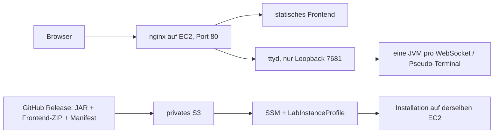
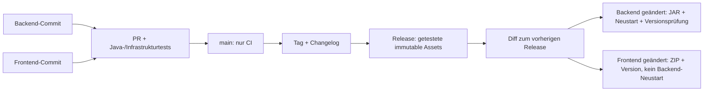

# TicTacTest: Deployment, Secrets und Reflexion

Diese Anleitung ersetzt die erste Cloud-Iteration in `CLOUD.md`. Die konkreten
Laufnachweise werden in [deployment-nachweise.md](deployment-nachweise.md) geführt.
Lokaler Betrieb ausschliesslich aus Release-Assets: [webkonsole.md](webkonsole.md).

## Architektur und Trennung



OpenTofu verwaltet EC2, LabInstanceProfile-Zuordnung, Elastic IP, Netzwerk,
Erstinstallation, nginx, Unit und SSM-Laufzeitkonfiguration. Das App-Deployment
verwaltet nur JAR, Frontend-Dateien und deren Versionsmetadaten. **Kein
Deployment-Workflow ruft OpenTofu auf.** Ein Push auf main startet CI, aber
kein App-Deployment. Die bestehende Coverage-Pages-Pipeline ist unabhängig
von der TicTacTest-App und wird nicht als App-Deployment gewertet.

Die feste Adresse ist eine Elastic IP. Ein Stop/Start behält sie bei; ein
`destroy` gibt sie frei. Der zugehörige AWS-DNS-Name steht als `web_url` im
Output. In diesem Schulnetz funktioniert die AWS-DNS-Adresse, während der
direkte HTTP-Aufruf der neuen numerischen IP eine vorgeschaltete 403-Seite
liefern kann. Die Anwendung liefert unter ihrem AWS-DNS-Namen normal aus.

Frontend-Hosting erfolgt bewusst ebenfalls auf nginx statt in einem öffentlichen
S3-Bucket: same-origin für iframe, WebSocket und Versionsabfrage; weniger
CORS-/Mixed-Content-Probleme und kein öffentlicher Artefakt- oder State-Bucket.
Die bereitgestellte Unterrichtsdemo nutzt HTTP. Für öffentlichen produktiven
Betrieb wären Domain, TLS, Authentisierung und Rate-Limits zu ergänzen.

Portregeln: 80 für Frontend, Terminal-Proxy und Versionsabfragen; SSH 22 nur
für die vertrauenswürdige /32 des Arbeitsplatzes. 7681 ist nur auf Loopback
gebunden und nicht freigegeben. 8080 aus dem Prototyp ist geschlossen.
Ausgehend sind AWS-API-, DNS- und Paketabrufe möglich.

ttyd ist auf 1.7.7 mit Hersteller-SHA-256 festgelegt. Corretto und nginx sind
mit Paketversion in `infrastructure/runtime/provision.sh` festgelegt. Deren
transitive Pakete stammen aus den signierten Amazon-Linux-Repositories;
ein vollständiger Paket-Snapshot wird nicht behauptet. Die Laufzeit startet
nie eine frei nutzbare Shell und läuft mit eigenen unprivilegierten Rechten.

## Einmaliger Infrastrukturaufbau

AWS-Lab starten, Profil mit allen drei temporären Werten ausserhalb des
Repositories einrichten. Region ist hier `us-east-1`. Keine eigenen IAM-Rollen:
`data.aws_iam_instance_profile.lab` liest das vorhandene `LabInstanceProfile`.
SSM-Agent und AWS CLI sind im Amazon-Linux-Image vorhanden. Die EC2 verwendet
die automatisch gelieferten Rollen-Credentials, keine statischen Access Keys.

State-Bucket und privater Artefakt-Bucket sind Bootstrap-Ressourcen. Namen
müssen global eindeutig sein, beispielsweise mit Account-ID und Zufallssuffix.
Der Artefakt-Bucket wurde zuerst mit `bucket_prefix` erstellt. Dieses Lab
verweigert dem AWS-Provider danach `GetBucketObjectLockConfiguration` durch
eine Organisationsrichtlinie. Deshalb ist die Bucket-Erstellung aus dem State
gelöst worden; Zugriffssperre, SSE-S3 und Versionierung bleiben in OpenTofu.
Es werden keine IAM-Sperren umgangen. Für einen Neuaufbau:

```powershell
$env:AWS_PROFILE = 'default'
$env:AWS_REGION = 'us-east-1'
$env:AWS_DEFAULT_REGION = 'us-east-1'
aws sts get-caller-identity
$bucket = "tictactest-artifacts-$([guid]::NewGuid().ToString('N'))"
aws s3api create-bucket --bucket $bucket --region us-east-1
# artifact_bucket = "..." in infrastructure/terraform.tfvars setzen
tofu '-chdir=infrastructure' init
tofu '-chdir=infrastructure' plan '-out=infra.tfplan'
tofu '-chdir=infrastructure' apply infra.tfplan
tofu '-chdir=infrastructure' output
```

Bestehenden S3-State migrieren statt mit leerem State neu beginnen; Anleitung
in `CLOUD.md`. State gehört ausschliesslich in den privaten State-Bucket.
OpenTofu erzeugt die Runtime-Skripte, Unit, nginx-Konfiguration und `config.js`.
`user_data_base64` enthält gzip-komprimiertes cloud-init für den ersten Boot.
Eine SSM-Association richtet auch die vorhandene Instanz ein und erlaubt
bewusste Infrastruktur-Updates. `user_data_replace_on_change = false` verhindert
eine Ersetzung; Updates können einen Stop/Start auslösen. `user_data` lädt
**kein Release-JAR** herunter. Nach dem Boot wird das bereits installierte JAR
vom persistenten EBS-Volume verwendet. Das Release ist keine IaC-Variable.

Outputs: `web_url`, `console_url`, `backend_version_url`, `frontend_version_url`,
`instance_id`, `artifact_bucket`, `public_ipv4`, `security_group_id`. Diese
Werte sind Konfiguration, keine Zugangsdaten. State selbst kann sensible
Informationen enthalten und wird trotzdem nicht öffentlich oder im Repo abgelegt.

## Secrets-Konzept

| Wert | Ablage | Quelle / Gültigkeit |
|---|---|---|
| AWS_ACCESS_KEY_ID, AWS_SECRET_ACCESS_KEY, AWS_SESSION_TOKEN | GitHub Environment `production`, Secrets | vollständiger Satz derselben Learner-Lab-Sitzung; läuft ab |
| GITHUB_TOKEN | automatisch je Job | nur Release-Assets lesen bzw. im Release-Job veröffentlichen |
| AWS_REGION, INSTANCE_ID, ARTIFACT_BUCKET, APP_URL | Environment Variables | lokale OpenTofu-Outputs, keine Geheimnisse |
| AUTO_DEPLOY | Repository Variable | normalerweise `true`; für die ersten beiden manuellen Übungen `false` |

Der finale Workflow benötigt **keinen SSH-Schlüssel**, keine SSH-Runner-Regel
und keinen Zugriff auf den OpenTofu-State. SSM hat gegenüber SSH den Vorteil,
dass kein eingehender CI-Zugang und kein privater SSH-Key nötig ist; es benötigt
aber Agent, Instance Profile und passende AWS-API-Rechte. Im Lab ist die Rolle
vorgegeben und breiter als ideal. Ausserhalb des Labs würden minimale getrennte
Deployment- und Instance-Rollen nur auf diesen Bucket und diese EC2 berechtigt.

Vor jedem Deployment wird `aws sts get-caller-identity` ausgeführt. Mit
abgelaufenen Credentials schlägt der Workflow **vor** S3/SSM-Mutationen fehl.
Neue Sitzung starten, alle drei Werte gemeinsam unter Settings → Environments →
production → Secrets aktualisieren, dann den vorhandenen Release mit „Deploy
release → Run workflow“ erneut deployen. Das JAR wird dabei nicht neu gebaut.
Die zuverlässige manuelle Erneuerung bleibt eine Lab-Aufgabe; ein Workflow kann
keine neue Lab-Sitzung erfinden. Eine absichtlich ungültige Credential-Prüfung
gehört zum Fehlernachweis, nicht zu einem veröffentlichten kaputten Release.

Secrets sind nach Speicherung nicht im Klartext lesbar. Berechtigte Maintainer
und Workflows können sie benutzen; wer Workflow-Code ändern darf, ist daher
sicherheitsrelevant. PR-Tests verwenden keine AWS-Secrets. Fork-PRs erhalten
normalerweise keine Secrets; `pull_request_target` wird nicht genutzt. GitHub
maskiert bekannte Secret-Werte in Logs, aber abgeleitete/transformierte Werte
können trotzdem lecken. Deshalb kein `set -x`, kein Ausgeben von Umgebungen,
Credentials oder State und keine Uploads solcher Dateien als Artefakte.

Bei Leak: Zugang sofort sperren/rotieren bzw. Lab-Credentials erneuern,
Auswirkungen/AWS-Aktivitäten prüfen, Logs und Git-Historie bereinigen. Das
Löschen einer Datei macht bereits veröffentlichte Schlüssel nicht wieder sicher.
Die im Chat früher geteilten temporären Credentials sind kein dauerhaftes
Produktionsgeheimnis und müssen spätestens vor der nächsten Sitzung ersetzt werden.

In einem Unternehmen: GitHub OIDC mit kurzlebigen STS-Sessions statt gespeicherten
AWS-Schlüsseln. Trust Policy auf Repository, Environment und Audience beschränken;
`id-token: write` nur für das Deployment. Siehe
[GitHub OIDC mit AWS](https://docs.github.com/en/actions/how-tos/secure-your-work/security-harden-deployments/oidc-in-aws).

## Release-Erkennung und Artefakte

Die Veroeffentlichung erfolgt zuerst als Draft: acht Assets hochladen, alle
Pruefsummen erneut pruefen, dann veroeffentlichen. Beobachtete GitHub-5xx
werden begrenzt wiederholt. Bereits publizierte Assets werden nicht ersetzt.

Ein `v*`-Tag baut und testet das JAR im **Release-Job**, paketiert plain
Frontend-Dateien und veröffentlicht JAR, Frontend-ZIP, lokale Tools,
`deployment.json` und SHA-256-Dateien. Deployment baut nichts. Die Java-Quellen
werden beim Betrieb nicht geändert oder auf EC2 kompiliert.

`scripts/release_assets.py` sucht mit `git describe --tags --abbrev=0 --match
'v[0-9]*' TAG^` den vorherigen erreichbaren App-Release-Tag. Es vergleicht die
vollständige Strecke `git diff --name-only PREVIOUS TAG`, nicht nur den letzten
Commit. Sonst gingen Änderungen aus mehreren Commits zwischen Releases verloren.
Devcontainer-Tags werden ausgeschlossen. Beim ersten Release gilt beides als
geändert. `fetch-depth: 0` sichert die Historie. Der Actions-`paths`-Filter löst
Workflows für Ereignisse aus; er ersetzt keine komponentenbezogene Release-Differenz.

| Pfade | Wirkung |
|---|---|
| src/main/, build.gradle, settings.gradle, gradle/, gradle.properties | Backend |
| frontend/ | Frontend |
| deploy/, infrastructure/runtime/, scripts/release_assets.py | beide (gemeinsamer Betrieb/Packaging) |
| VERSION, CHANGELOG.md, docs/, README, Tests | keine App-Komponente |
| Workflow-Dateien, scripts/publish_release.py, scripts/deploy_cloud.py | Transport-/Release-Werkzeug; kein automatischer App-Neustart |

Die Versionsnummer allein zählt nicht als Backend-Änderung: Ein neuer
JAR-Manifestwert würde sonst jeden Frontend-Release zum Backend-Release machen.
Alle Assets werden zwar reproduzierbar für den Tag bereitgestellt, aber im
automatischen Deployment wird nur die im Manifest markierte Komponente aktiviert.
Backend- und Frontend-Version können daher absichtlich verschieden sein.

`deployment-state.json` auf EC2 merkt den zuletzt angewandten Release. Ist die
Umgebung nicht auf dem im Manifest erwarteten Vorgänger (z. B. nach Rollback,
ausgelassenem Release oder Neuaufbau), werden beide Komponenten hergestellt.
Ein manueller gezielter Deploy stellt ebenfalls immer beide Komponenten her.
Die manuelle Wiederholung ist deshalb ein Wiederherstellungsmodus, kein Test
für „Frontend-only“; dieser Nachweis benötigt einen normalen neuen Release.

## Manuelles Deployment A und B ohne IaC

Die folgenden Schritte sind identisch zur CI. Der Repo-Checkout stellt nur das
Deployment-Werkzeug; JAR und Frontend stammen ausschliesslich aus dem Release.
Assets mit Browser oder `gh release download TAG --dir release-assets`
herunterladen. Für einen neuen Tag einen leeren Downloadordner verwenden.

```powershell
$env:TAG = 'v1.3.0' # für Release B auf dessen Tag ändern
$env:FORCE = 'true'
$env:INSTANCE_ID = tofu '-chdir=infrastructure' output -raw instance_id
$env:ARTIFACT_BUCKET = tofu '-chdir=infrastructure' output -raw artifact_bucket
$env:APP_URL = tofu '-chdir=infrastructure' output -raw web_url
Get-ChildItem release-assets/*.sha256 | ForEach-Object {
  $parts = (Get-Content $_.FullName) -split '\s+'
  $actual = (Get-FileHash "release-assets/$($parts[1])" -Algorithm SHA256).Hash.ToLower()
  if ($actual -ne $parts[0]) { throw 'Checksum mismatch' }
}
python scripts/deploy_cloud.py
Invoke-RestMethod "$env:APP_URL/backend-version.json"
Invoke-RestMethod "$env:APP_URL/version.json"
tofu '-chdir=infrastructure' plan
```

Zwischen A und B erfolgt **kein** `tofu apply` und keine EC2-Ersetzung. Die
Pipeline verwendet dieselben S3-/SSM-Schritte. S3 liegt privat; auch private
GitHub-Repositories funktionieren, weil der Actions-Job Assets mit GITHUB_TOKEN
liest und die EC2 nur über ihre Rolle aus S3 liest.

Der Installer prüft Prüfsummen und JAR-Manifest, startet das neue JAR probeweise
und wartet höchstens 20 Sekunden auf den Spielprompt. Erst dann wird es
installiert und ttyd neu gestartet. Ein defektes JAR lässt die bisherige Version
weiterlaufen; bei einem späteren Dienstfehler wird das vorige JAR wiederhergestellt.
Danach prüft der Job beide tatsächlich erwarteten Versionen öffentlich per HTTP
(bis 20 Versuche à 2 Sekunden, HTTP-Timeout 4 Sekunden). Fehler schlagen den
Workflow fehl. SSM hat zusätzlich einen 240-Sekunden-Gesamttimeout.

Frontend-ZIP wird in ein eigenes Versionsverzeichnis entpackt, Pfadtraversal und
`config.js` darin werden abgewiesen. Ein atomarer Symlink ersetzt den gesamten
ausgelieferten Baum; entfernte Dateien verschwinden damit ebenfalls. Die von
IaC erzeugte Datei `/opt/tictactest/config.js` liegt ausserhalb dieses Baums und
wird über eine eigene nginx-Location ausgeliefert. Ein versehentliches Löschen
würde Terminal-URL und Versionsanzeige beschädigen; das Deployment darf sie daher
gar nicht verwalten. Frontend-Deploys starten ttyd nicht neu.

GitHub `concurrency` serialisiert Deployments; ein zusätzlicher `flock` auf der
Instanz schützt auch vor einem gleichzeitig gestarteten manuellen Deploy.

## Rollback, Neustart und Wiederaufbau

Actions → Deploy release → Run workflow → existierenden Tag eingeben. Der
Workflow verwendet aktuelle Deployment-Werkzeuge, lädt aber die Artefakte des
gewählten Tags. Bereits veröffentlichte Legacy-Releases ohne Frontend benötigen
einmalig ergänzte kompatible Frontend-/Manifest-Assets; ihre JARs bleiben unverändert.
Solche Ergänzungen müssen als Migration in den Release-Notes gekennzeichnet werden.

Ein normaler Stop/Start erhält EBS, App-Dateien, Versionen und EIP. systemd
aktiviert nginx und ttyd beim Booten. Ein Backend-Neustart bricht laufende Partien
ab, ein reiner Frontend-Deploy lässt die verbundenen Java-Prozesse weiterlaufen.

Nach `destroy`/`apply` ändern sich Instanz-ID, EIP, DNS und ggf. Ressourcen-IDs;
das Rootvolume ist neu. Private Bootstrap-Buckets und Release-Assets bleiben
erhalten. Outputs nach GitHub Variables übernehmen (`INSTANCE_ID`, `APP_URL`,
ggf. `ARTIFACT_BUCKET`), SSM-Onlinezustand abwarten und gewünschten Release manuell
deployen. Keine statische JAR-Version gehört in user_data.

Ein echter Lab-Session-Wechsel muss über die Lab-Oberfläche erfolgen. Stop/Start
testet die technische Persistenz, ersetzt aber keinen Nachweis für das Verhalten
der Lab-Plattform. Der vollstaendige destroy/apply-Versuch wurde auf dem Lern-Stack ausgefuehrt
und Release 1.3.4 auf der neuen Instanz wiederhergestellt. Alte und neue Werte
sowie der erfolgreiche Actions-Lauf stehen im Nachweis. Nur ein echter
Session-Wechsel ueber die Learner-Lab-Oberflaeche bleibt manuell zu pruefen.

### Letzter manueller Plattformtest beim nächsten Unterricht

1. Vor dem Beenden die Spieladresse und beide aktuellen HTTP-Versionen notieren.
   Nach dem Feature-Release 1.4.0 sind beide 1.4.0; für spätere Releases immer
   die unmittelbar vor dem Lab-Ende abgefragten Werte vergleichen.
2. In der Learner-Lab-Oberfläche **End Lab** ausführen, danach **Start Lab**
   und auf die Bereitschaft warten. Kein Lab-Reset verwenden.
3. Die neue vollständige Credential-Dreiergruppe lokal und vor dem nächsten
   CI-Deploy in den drei GitHub-Secrets der Umgebung production aktualisieren.
4. Dieselbe Spieladresse öffnen, eine Partie spielen und `/backend-version.json`
   sowie `/version.json` vergleichen. Es soll kein App-Deployment nötig sein.
   Falls die Plattform die EC2 gestoppt lässt, dieselbe Instanz starten und
   diesen Unterschied zum automatischen Lab-Wiederanlauf dokumentieren.
5. Ergebnis und Datum im Nachweis ergänzen. Damit wird das Plattformverhalten
   zusätzlich zu den bereits bestandenen EC2-Stop/Start- und Neuaufbau-Tests belegt.

## Reflexion: Weg einer Änderung und Promotion



Automatisiert: Release-Build, Checksummen, Differenz, Übertragung, Aktivierung
und Versionsprüfungen. Manuell: Änderungen/Review, Versions-Tag, IaC-Änderungen,
Lab starten und Secrets erneuern. Die Veröffentlichung eines Releases geht in
dieser Übungsumgebung direkt nach `production`, ohne zusätzliche Freigabe.

Für dev/staging/prod: dieselben Module, aber getrennte States/Backend-Keys,
Instanzen, EIPs, Speicherpräfixe, Secrets und GitHub Environments. Gleich bleiben
Laufzeit und Installationslogik; unterschiedlich sind URLs, Kapazität, Netzregeln
und Zugriffsrechte. Drei Environment-Tags allein trennen keine Infrastruktur.

Promotion baut **einmal** und reicht genau dieselben geprüften Assets und deren
Digests weiter. Pro Umgebung neu bauen würde einen anderen, noch ungeprüften
Stand erzeugen. Vorschlag: Tag veröffentlicht Kandidat → automatisches dev →
Smoke-/Terminaltest → staging mit Integrations-/Lasttests → manuelle Freigabe
durch berechtigte Required Reviewers des prod-Environments → Produktion mit
Healthcheck und Rollback-Möglichkeit. Ein Push allein deployt auch dann keine
Produktion; die Trigger für dev sind eine explizite spätere Designentscheidung.

Bei unterschiedlich weit fortgeschrittenen Umgebungen darf man nicht blind den
globalen vorherigen Release als ihren Istzustand annehmen. Jede Umgebung benötigt
ihren eigenen zuletzt deployten Stand oder Komponenten-Digests. Unser Iststand-
Abgleich erkennt Abweichungen und stellt dann beide Zielkomponenten her; eine
ausgebaute Promotion-Pipeline würde pro Umgebung die wirklich fehlenden Digests
übertragen und nur nötige Komponenten aktivieren.

Quellen: [GitHub Secrets](https://docs.github.com/en/actions/how-tos/write-workflows/choose-what-workflows-do/use-secrets),
[OIDC und AWS](https://docs.github.com/en/actions/how-tos/secure-your-work/security-harden-deployments/oidc-in-aws),
[ttyd](https://github.com/tsl0922/ttyd),
[AWS EC2 Instance Profiles](https://docs.aws.amazon.com/IAM/latest/UserGuide/id_roles_use_switch-role-ec2_instance-profiles.html).
